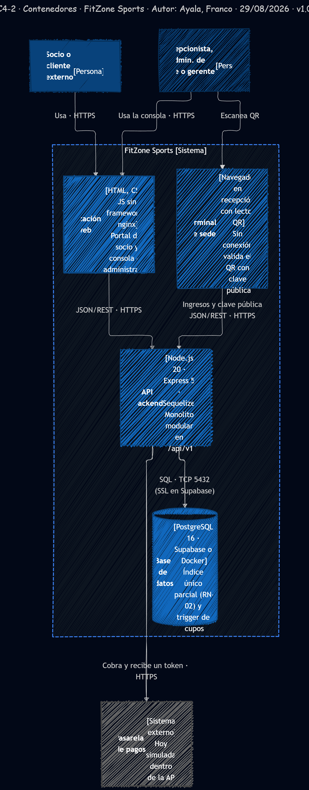
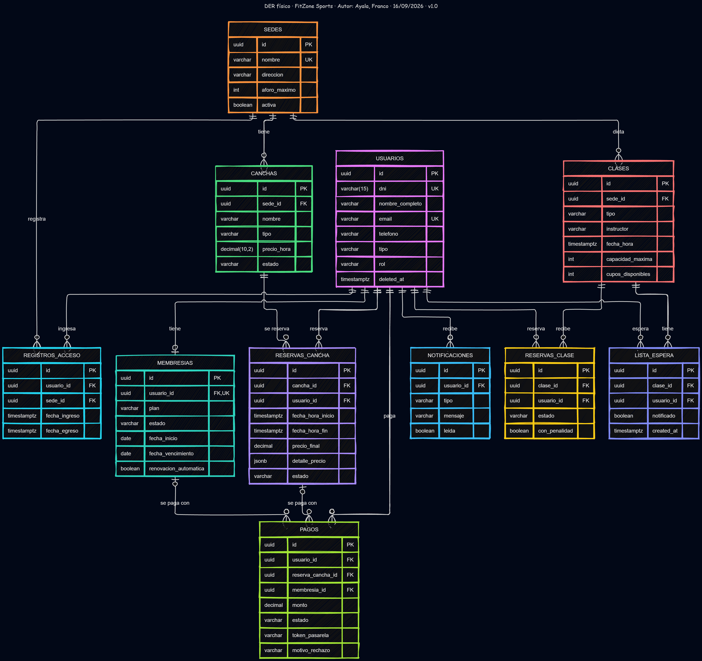
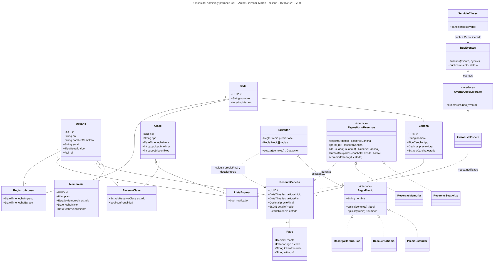
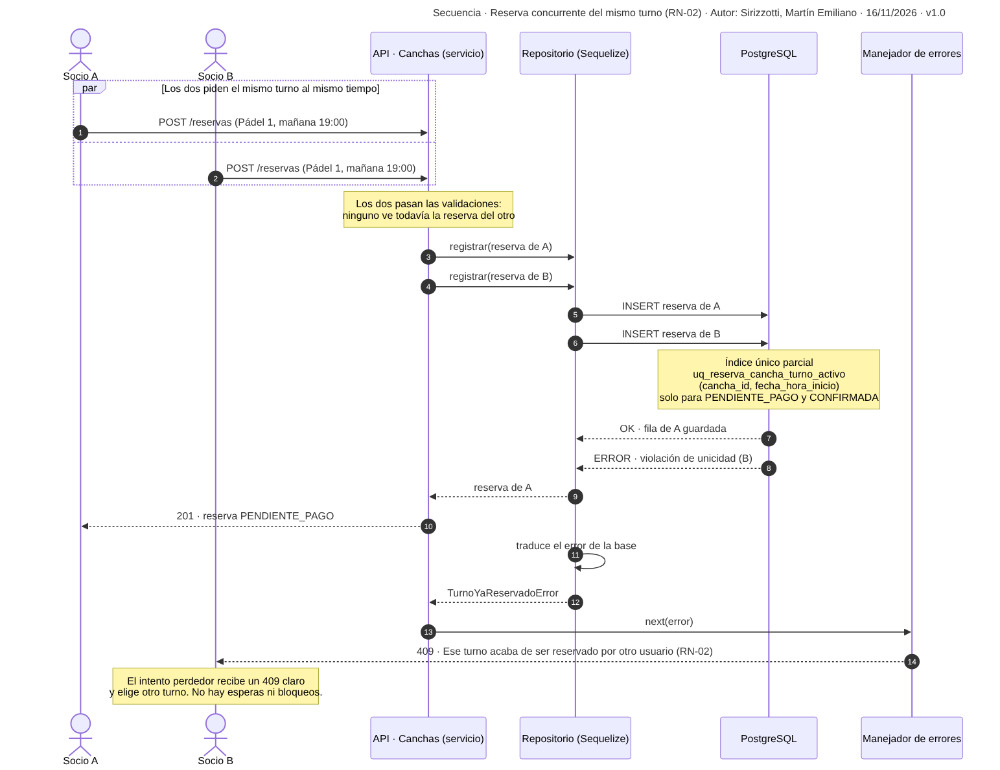
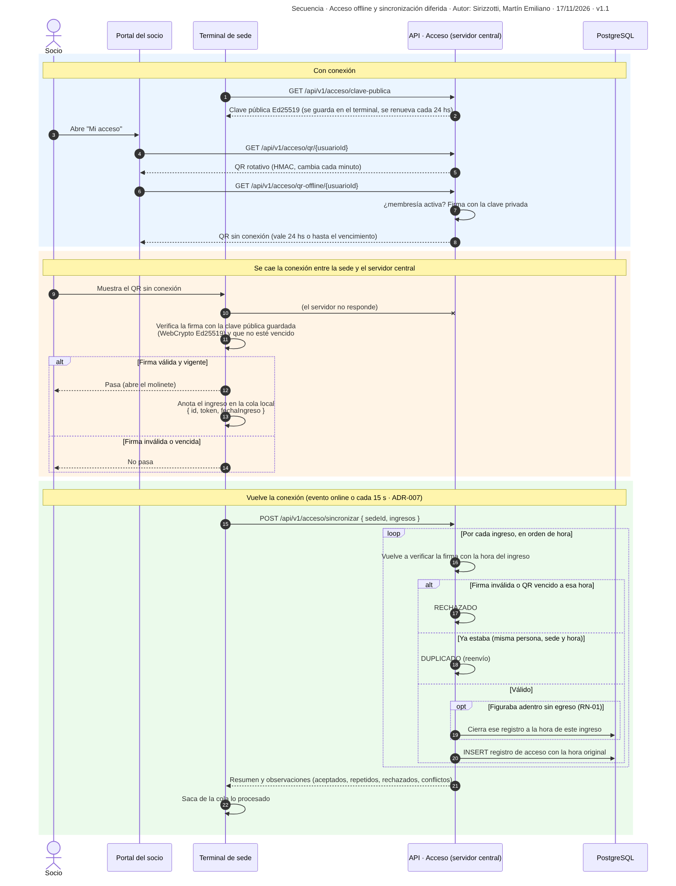
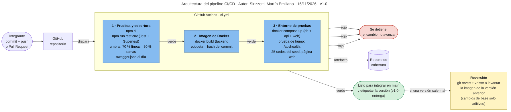

# Manual técnico — FitZone Sports

- **Autores:** Ayala, Franco · Sirizzotti, Martín Emiliano · Villagra, Santiago Agustín
- **Fecha:** 18/11/2026 · **Versión:** 1.0
- **Alcance:** cómo está construido el sistema, por qué, y cómo se extiende. Sigue el índice del Anexo F de los lineamientos de entrega. Está pensado para un desarrollador que se suma al proyecto.

> Redactado con ayuda de IA (Claude) y verificado contra el código del repositorio. Las rutas de archivo son relativas a `Backend/` salvo que se indique otra cosa.

---

## 1. Visión arquitectónica · Diagramas C4 · Índice de ADR

FitZone Sports es un **monolito modular** (ADR-001): una sola API REST en Node.js 20 con Express 5, organizada en un módulo por dominio, con una base PostgreSQL 16 (ADR-002) y una aplicación web en HTML, CSS y JavaScript sin framework (ADR-006). Todo se levanta con `docker compose up --build` (ADR-009).

| Nivel | Diagrama |
|---|---|
| C4-1 · Contexto: quién usa el sistema y con qué sistemas externos habla | [`docs/diagramas/c4-1-contexto.png`](../diagramas/c4-1-contexto.png) |
| C4-2 · Contenedores: aplicación web, terminal de sede, API y base | [`docs/diagramas/c4-2-contenedores.png`](../diagramas/c4-2-contenedores.png) |
| C4-3 · Componentes del módulo Canchas | [`docs/diagramas/c4-3-canchas.png`](../diagramas/c4-3-canchas.png) |
| C4-3 · Componentes del módulo Acceso | [`docs/diagramas/c4-3-acceso.png`](../diagramas/c4-3-acceso.png) |
| Despliegue | [`docs/diagramas/despliegue.png`](../diagramas/despliegue.png) |



### Índice de ADR

| Nº | Decisión |
|---|---|
| ADR-001 | Estilo arquitectónico: monolito modular |
| ADR-002 | PostgreSQL alojado en Supabase (o en Docker) |
| ADR-003 | Acceso sin conexión: QR firmado con clave pública |
| ADR-004 | Concurrencia en reservas: índice único parcial |
| ADR-005 | Express, inversión de control manual (composition root) y Sequelize |
| ADR-006 | Frontend multipágina y estado |
| ADR-007 | Sincronización del terminal de sede |
| ADR-008 | Estrategia de pruebas y cobertura mínima |
| ADR-009 | Despliegue con Docker, pipeline y reversión |
| ADR-010 | Medios de pago: tokenización |
| ADR-011 | Versionado de la API por URL (`/api/v1`) |
| ADR-012 | Sin app móvil nativa |
| ADR-013 a ADR-015 | Patrones Strategy, Repository y Observer |
| ADR-016 | Varios códigos QR, con firma HMAC y Ed25519 |

El detalle está en [`docs/adr/`](../adr/README.md).

### Recorrido de un pedido

Todos los módulos siguen el mismo camino:

```
ruta (*.routes.js) → validadores (*.validators.js) → common/validar.js → controlador (*.controller.js)
  → servicio (*.service.js) → repositorio o modelo → PostgreSQL
cualquier error lanzado → core/errorHandler.js → respuesta JSON { error } con su código HTTP
```

- **La ruta** define la URL y el orden de los pasos, y lleva el comentario `@swagger` que genera la documentación.
- **El validador** controla la forma de los datos (UUID, fechas ISO 8601, valores permitidos); si algo falla, `validar.js` corta con 400.
- **El controlador** traduce HTTP a una llamada al servicio; no tiene reglas.
- **El servicio** tiene las reglas de negocio y no conoce HTTP.
- **El manejador de errores** usa el `status` del error. Un `AppError(mensaje, código)` sale con su código; un `Error` común, con 400.

Todas las piezas se arman en **`src/core/compositionRoot.js`** (inversión de control manual, ADR-005): cada servicio es una función fábrica `crearXService({ dependencias })` que recibe todo lo que usa. Es el único archivo que conoce las implementaciones concretas, y es lo que permite que las pruebas armen los mismos servicios con repositorios en memoria.

---

## 2. Los cinco módulos funcionales y sus responsabilidades

| Módulo | Carpeta | Requisitos | Responsabilidades |
|---|---|---|---|
| **M1 · Socios y membresías** | `src/modules/usuarios`, `membresias`, `sedes` | RF-01 a RF-03 | Alta de usuarios con su membresía en una transacción; planes y estados de la membresía (paso perezoso a VENCIDO); renovación y suspensión; regla `esSocioActivo` (RN-03); sedes y su aforo. |
| **M2 · Control de acceso** | `src/modules/acceso` | RF-04, RF-05, RN-01, RNF-01 | QR rotativo del socio (HMAC, cambia cada minuto); QR sin conexión (Ed25519); ingreso con QR del socio o de una reserva; aforo; egreso; una sola sede a la vez (RN-01). |
| **M3 · Clases grupales** | `src/modules/clases` | RF-06 a RF-08 | Agenda de clases; reservas hasta 48 hs antes con bloqueo de la fila; cancelación con penalidad si faltan menos de 2 hs; lista de espera con aviso (Observer); QR y registro de asistencia. |
| **M4 · Canchas** | `src/modules/canchas` | RF-09 a RF-12, RN-02 | Canchas por sede y su estado; grilla de turnos de 8 a 23; precio dinámico (Strategy); reserva sin sobreventa (Repository + índice único); QR de la reserva paga. |
| **M5 · Pagos** | `src/modules/pagos` | RF-13, RF-14, RNF-02 | Cobro a través de la pasarela (simulada) con tokenización; confirmación de la reserva; comprobante PDF con QR de ingreso y de verificación; verificación pública del comprobante. |

Dependencias entre módulos (todas inyectadas en el composition root): canchas, clases y acceso usan `usuariosService` y `sedesService`; acceso usa `canchasService` para validar el QR de una reserva; pagos usa `canchasService` para confirmar la reserva.

---

## 3. Modelo de datos y convenciones de persistencia



Once tablas: `usuarios`, `membresias`, `sedes`, `registros_acceso`, `canchas`, `reservas_cancha`, `clases`, `reservas_clase`, `lista_espera`, `pagos` y `notificaciones`. El script completo está en `db/01-esquema.sql`; los datos de prueba, en `db/02-seed.sql`.

**Convenciones:**

| Convención | Detalle |
|---|---|
| Claves | UUID generadas por la base (`gen_random_uuid()`). |
| Nombres | Tablas y columnas en `snake_case` en la base; atributos en `camelCase` en los modelos de Sequelize (`underscored: true` hace la traducción). |
| Valores permitidos | Columnas `VARCHAR` con restricciones `CHECK` (no tipos `ENUM` de PostgreSQL: `sequelize.sync` no los sabía migrar). Los mismos valores están en `src/common/enums.js`. |
| Esquema | Lo crea el script SQL versionado, nunca Sequelize: `sync` está desactivado (ADR-002). |
| Borrado | `usuarios` usa borrado lógico (`paranoid: true`, columna `deleted_at`). |
| Fechas | `TIMESTAMPTZ` para instantes; `DATE` para las fechas de la membresía. La API y la base trabajan en hora argentina (`TZ=America/Argentina/Buenos_Aires` en Docker). |
| Dinero | `DECIMAL(10,2)`. Sequelize lo devuelve como texto: se convierte con `Number()` antes de calcular. |
| Reglas en la base | Índice único parcial `uq_reserva_cancha_turno_activo` (RN-02), `chk_pago_concepto` (un pago es de una reserva o de una membresía), únicos `(clase_id, usuario_id)` en reservas de clase y lista de espera, y el trigger `trg_actualizar_cupos_clase`, que descuenta y devuelve cupos. |

---

## 4. Patrones de diseño aplicados y su ubicación en el código



### 4.1 Strategy — precio dinámico de canchas (ADR-013)

| Pieza | Archivo |
|---|---|
| Contexto | `src/modules/canchas/strategies/tarifador.js` |
| Precio base | `strategies/standarPricing.js` |
| Estrategias | `strategies/memberDiscountPricing.js` (−15 % socio activo), `strategies/peakHourPricing.js` (+20 % de 19 a 21 hs; exporta también `esHorarioPico`, que usa la grilla) |
| Dónde se arma la lista | `src/core/compositionRoot.js` |

Cada estrategia es un objeto con `nombre`, `aplica(contexto)` y `aplicar(precio)`. El `Tarifador` parte del precio base y aplica en orden las reglas que corresponden, guardando el detalle (concepto y monto) que se muestra al cliente y se guarda en la reserva (`detalle_precio`). Una regla nueva no modifica el Tarifador ni el servicio (abierto/cerrado; ver 7.2). Se eligió sobre un Decorator porque cada regla se prueba sola y se agrega a una lista sin anidar objetos.

### 4.2 Observer — lista de espera de clases (ADR-015)

| Pieza | Archivo |
|---|---|
| Sujeto (bus de eventos) | `src/common/bus-eventos.js`, sobre el `EventEmitter` de Node |
| Publicador | `src/modules/clases/clases.service.js` → `cancelarReserva` publica `CupoLiberado` |
| Observador | `src/modules/clases/observer/waitlistNotifier.js` |
| Suscripción | `src/core/compositionRoot.js` |

Decisiones: el evento se publica **después** de guardar la cancelación; si un oyente falla, el error se registra y no afecta a los demás ni a la cancelación; la respuesta HTTP no espera a los oyentes. El oyente avisa al primero no avisado de la lista (orden de llegada) y lo marca `notificado`; avisar no es reservar. Flujo completo en [`docs/diagramas/actividad-lista-espera.png`](../diagramas/actividad-lista-espera.png).

### 4.3 Repository — abstracción de la persistencia (ADR-014)

| Pieza | Reservas de cancha | Membresías |
|---|---|---|
| Contrato y errores del dominio | `canchas/repositorio/reservas.puerto.js` (`TurnoYaReservadoError`) | `membresias/repositorio/membresias.puerto.js` (`MembresiaDuplicadaError`) |
| Adaptador real | `reservas.sequelize.js` | `membresias.sequelize.js` |
| Adaptador en memoria (pruebas) | `reservas.memoria.js` | `membresias.memoria.js` |

Se aplicó donde hay reglas que probar sin base. El adaptador de Sequelize traduce la violación del índice único a un error del dominio (409), así el servicio no conoce los errores de Sequelize. Sedes, usuarios, clases y pagos usan los modelos directamente (deuda asumida en el ADR-005).

### 4.4 Patrones creacionales y estructurales

| Patrón | Dónde | Para qué |
|---|---|---|
| **Factory** (funciones fábrica) | Todos los servicios, controladores y routers: `crearCanchasService`, `crearTarifador`, `crearAvisoListaEspera`… | Construir cada pieza con sus dependencias explícitas, sin `new` ni estado global. |
| **Composition Root** (inyección de dependencias) | `src/core/compositionRoot.js` | Único punto donde se conectan las implementaciones concretas. |
| **Singleton** (de módulo) | `src/core/db.js` (una instancia de Sequelize por proceso); el bus de eventos, creado una sola vez en el composition root | Compartir una única conexión y un único bus. |
| **Adapter** | Los adaptadores Sequelize y en memoria del Repository; `pasarela-mock.js` como adaptador de la pasarela de pagos | Que el dominio dependa de un contrato propio y no de la librería o del proveedor. |
| **Facade** | Los servicios de cada módulo frente a los controladores | Exponer operaciones de negocio simples (`reservar`, `pagarReserva`) que coordinan varias piezas. |

---

## 5. Control de concurrencia en las reservas



**Canchas (RN-02, ADR-004).** La garantía la da la base:

```sql
CREATE UNIQUE INDEX uq_reserva_cancha_turno_activo
  ON reservas_cancha (cancha_id, fecha_hora_inicio)
  WHERE estado IN ('PENDIENTE_PAGO', 'CONFIRMADA');
```

Si dos pedidos intentan el mismo turno, PostgreSQL acepta uno y rechaza el otro de forma atómica. `reservas.sequelize.js` traduce el rechazo a `TurnoYaReservadoError`, y el manejador de errores responde **409** «Ese turno acaba de ser reservado por otro usuario». Como el índice es parcial, una reserva cancelada libera el turno. No se usó una verificación previa en el código (dos pedidos simultáneos la pasarían los dos) ni un bloqueo pesimista (una reserva nueva no tiene fila que bloquear).

**Clases.** Para el último cupo de una clase sí se usa **bloqueo pesimista**: `clases.service.js` reserva dentro de una transacción con `lock: UPDATE` sobre la fila de la clase, porque ahí hay una fila (el contador de cupos) que todos modifican. El trigger de la base descuenta el cupo.

**Cómo se prueba.** `test/unit/reservas-cancha.test.js` y `test/integracion/canchas.api.test.js` verifican el 409 con el repositorio en memoria, que imita el índice. La prueba de concurrencia contra un PostgreSQL real está como deuda en el ADR-008.

---

## 6. Arquitectura offline del control de acceso



| Pieza | Archivo | Estado |
|---|---|---|
| QR rotativo del socio: `usuarioId.minuto.firma`, HMAC con `QR_SECRET`, se acepta el minuto anterior | `src/modules/acceso/qr-token.js` | Implementado |
| QR sin conexión: payload firmado con **Ed25519**, vale 24 hs o hasta el vencimiento de la membresía; la clave privada se deriva de `QR_OFFLINE_SEMILLA` (o de `QR_SECRET`) para que no cambie al reiniciar | `src/modules/acceso/qr-offline.js` | Implementado |
| Clave pública para los terminales | `GET /api/v1/acceso/clave-publica` | Implementado |
| Validación de la firma en el servidor sin consultar la base (respaldo si el navegador no tiene Ed25519) | `POST /api/v1/acceso/validar-offline` | Implementado |
| Validación local en el navegador del terminal: guarda la clave pública (se renueva cada 24 hs) y verifica la firma con WebCrypto Ed25519, sin red | `Frontend/js/terminal-offline.js` | Implementado |
| Cola local de ingresos (`localStorage`) que se envía al volver la conexión (evento `online`, cada 15 s o «Sincronizar ahora») | `Frontend/js/terminal-offline.js` · `recepcion.js` | Implementado |
| `POST /api/v1/acceso/sincronizar`: vuelve a verificar cada firma con la hora del ingreso, descarta reenvíos (persona + sede + hora) y resuelve RN-01 cerrando el registro abierto a la hora del ingreso nuevo | `acceso.service.js` → `sincronizarIngresos()` (ADR-007) | Implementado, con 12 pruebas unitarias y 2 de integración |

Por qué clave pública y no HMAC (ADR-003): para verificar un HMAC el terminal necesitaría el secreto, y quien lo extrajera podría fabricar QR. Con Ed25519, el terminal solo tiene la clave pública, que sirve para verificar pero no para firmar.

Los otros QR firmados del sistema (reserva de cancha, asistencia a clase, comprobante) usan `src/common/qr-firmado.js`: token `payload-base64url.firma-HMAC`, con tipo (`t`) y vigencia (`nbf`, `exp`) dentro del payload, para que un QR de un tipo no sirva como otro (ADR-016).

---

## 7. Guía de extensión

Receta general: ubicar la capa (forma del dato → validador; regla de negocio → servicio o estrategia; valor permitido → `enums.js` + `CHECK` en la base; armado → composition root), hacer el cambio mínimo, correr `npm test`, probar en Swagger.

### 7.1 Caso resuelto: agregar canchas de tenis

El código **ya acepta** el tipo: `src/common/enums.js` incluye `TENIS` y el validador usa `Object.values(TipoCancha)`. Lo que lo frena es la restricción de la base.

1. Aplicar en la base:

   ```sql
   ALTER TABLE canchas DROP CONSTRAINT canchas_tipo_check;
   ALTER TABLE canchas ADD CONSTRAINT canchas_tipo_check CHECK (tipo IN ('FUTBOL', 'PADEL', 'TENIS'));
   ```

2. Actualizar el mismo `CHECK` en `db/01-esquema.sql` para las bases nuevas.
3. Agregar la opción en `Frontend/gestion.html`: `<option value="TENIS">Tenis</option>` (los nombres en `js/gestion.js` ya incluyen Tenis).
4. Probar `POST /api/v1/canchas` con `"tipo": "TENIS"`.

No se tocan servicios, reglas de precio ni la grilla: una cancha de tenis se reserva, cotiza y paga como las demás. Pruebas: no cambia ninguna.

### 7.2 Caso resuelto: agregar una estrategia de precio

Ejemplo: recargo del 10 % los sábados y domingos.

1. Archivo nuevo `src/modules/canchas/strategies/weekendPricing.js`:

   ```js
   'use strict';

   const RECARGO_FIN_DE_SEMANA = 0.10;

   function esFinDeSemana(fecha) {
     const dia = new Date(fecha).getDay(); // 0 = domingo, 6 = sábado
     return dia === 0 || dia === 6;
   }

   function crearRecargoFinDeSemana({ porcentaje = RECARGO_FIN_DE_SEMANA } = {}) {
     return {
       nombre: `Recargo fin de semana (${Math.round(porcentaje * 100)}%)`,
       aplica: (ctx) => esFinDeSemana(ctx.inicio),
       aplicar: (precio) => precio * (1 + porcentaje),
     };
   }

   module.exports = { crearRecargoFinDeSemana, esFinDeSemana, RECARGO_FIN_DE_SEMANA };
   ```

2. En `src/core/compositionRoot.js`: el `require` y la regla en la lista del Tarifador, después del recargo pico. El orden es una decisión de negocio (el recargo se aplica sobre el precio ya descontado).
3. En `test/dobles/fitzone.js`: la misma regla en `tarifadorFitZone`, para que las pruebas usen la misma cadena que producción.
4. Prueba nueva `test/unit/precio-fin-de-semana.test.js`: la regla aplica sábado y domingo y no un miércoles; un externo el sábado paga 1100 sobre 1000; un socio, 1000 → 850 → 935.

No se tocan `tarifador.js`, `canchas.service.js`, las otras estrategias ni el frontend (el detalle del precio se dibuja con lo que devuelve el Tarifador). Este cambio se probó: las 100 pruebas siguen pasando y se suman 3.

---

## 8. Pruebas: cómo correrlas y cómo leer la cobertura

```bash
cd Backend
npm test                  # 113 pruebas
npm test -- precios       # solo los archivos que contienen "precios"
npm run test:cov          # con reporte de cobertura
```

| Carpeta | Qué prueba |
|---|---|
| `test/unit/` (83 pruebas) | Reglas de cada servicio y patrón: estrategias de precio, RN-02 con repositorio en memoria, membresías (incluidas pruebas de caracterización), Observer, los cinco tipos de QR. |
| `test/integracion/` (30 pruebas) | La API por HTTP con Supertest: router, validadores, servicio y manejador de errores reales, con repositorio en memoria. Incluye una prueba de humo de la app completa y de `/api/v1`. |
| `test/dobles/fitzone.js` | Dobles compartidos: *fakes* (repositorios en memoria), *stubs* (servicio de usuarios con datos fijos) y *mocks* (`jest.fn()`). |

Ninguna prueba usa la base de datos real (ADR-008).

**Cómo leer la cobertura.** `npm run test:cov` imprime una tabla por archivo y un resumen; el detalle navegable queda en `coverage/lcov-report/index.html`. Las columnas son:

| Columna | Qué mide |
|---|---|
| `% Stmts` | Sentencias ejecutadas por alguna prueba |
| `% Branch` | Ramas de `if`, `?:` y `&&` recorridas en sus dos caminos |
| `% Funcs` | Funciones llamadas al menos una vez |
| `% Lines` | Líneas ejecutadas |

Al 17/11/2026: **82,3 % de líneas y 61,5 % de ramas**. El umbral (`coverageThreshold` en `package.json`) es **70 % de líneas y 50 % de ramas**: si un cambio lo baja, `npm run test:cov` falla y el pipeline también. Las líneas sin cubrir más grandes son las de acceso a la base que no pasan por repositorios (sedes, usuarios, pagos), cubiertas solo por la prueba manual de punta a punta.

---

## 9. Pipeline de integración y entrega continuas



Archivo: `.github/workflows/ci.yml` (en la raíz del repositorio). Corre en cada Pull Request y en cada push a `main`; cada etapa necesita que la anterior termine en verde.

| Etapa | Pasos |
|---|---|
| 1 · Pruebas y cobertura | `npm ci` · `npm run test:cov` (falla si no se alcanza el umbral) · guarda el reporte como artefacto · regenera `swagger.json` con `npm run swagger:export` y falla si difiere del versionado |
| 2 · Imagen de Docker | `docker build` de `Backend/`, etiquetada con el hash del commit |
| 3 · Entorno de pruebas | `docker compose up --wait` (base, API y web) · prueba de humo: `/api/health`, al menos 25 sedes del seed, la página de inicio · registros si falla · `docker compose down -v` |

La reversión (tag de versión, `git revert`, imagen anterior, cambios de base solo aditivos) está en el manual de instalación, sección 6, y en el ADR-009.

---

## 10. Convenciones de código, ramas y mensajes de commit

**Código**

| Tema | Convención |
|---|---|
| Lenguaje y módulos | JavaScript (Node 20), CommonJS (`require` / `module.exports`), `'use strict'` al principio de cada archivo. |
| Nombres | Español para el dominio (`reservar`, `cancelarReserva`, `esSocioActivo`); `camelCase` para funciones y variables, `PascalCase` para modelos, `MAYÚSCULAS` para constantes de negocio (`DESCUENTO_SOCIO`, `HORAS_ANTICIPACION_MAX`). |
| Archivos | Por módulo: `<modulo>.routes.js`, `.validators.js`, `.controller.js`, `.service.js`, `.model.js`; repositorios en `repositorio/`, estrategias en `strategies/`, oyentes en `observer/`. |
| Construcción | Funciones fábrica `crearX({ dependencias })`; ninguna pieza crea sus dependencias. |
| Errores | `throw new AppError(mensaje, códigoHTTP)` para errores de negocio; nunca responder desde el servicio. |
| Validación | Siempre con express-validator en la ruta, antes del controlador. |
| Documentación de la API | Comentario `@swagger` junto a cada ruta; después de cambiar rutas, `npm run swagger:export`. |
| Secretos | Solo por variables de entorno; los `.env` nunca se suben. |

**Ramas.** `main` es la rama protegida por el pipeline. Cada cambio se integra con un commit propio (o una rama y un Pull Request); los laboratorios usaron ramas aparte (por ejemplo `contrato-api`, Laboratorio 2). La versión entregada se marca con el tag anotado `v1.0-entrega`.


