# Manual de usuario — FitZone Sports

- **Autor:** Villagra, Santiago Agustín
- **Fecha:** 18/11/2026 · **Versión:** 1.0
- **Alcance:** cómo usa el sistema cada persona: socio, cliente externo, recepcionista, administrador de sede y gerente central. Sigue el índice del Anexo D de los lineamientos de entrega.

> Borrador redactado con ayuda de IA (Claude) a partir de la aplicación funcionando; las capturas son de la aplicación real con los datos de prueba del seed. Revisado por el autor.

---

## 1. Qué es FitZone Sports y para qué sirve

FitZone Sports es el sistema de la cadena de gimnasios FitZone, con más de 25 sedes. Desde una sola aplicación web se puede:

- hacerse **socio** y tener la membresía al día;
- **entrar a cualquier sede** mostrando un código QR desde el celular;
- **reservar un lugar en clases grupales** (funcional, spinning, yoga…) y anotarse en lista de espera si la clase está llena;
- **alquilar canchas** de pádel y fútbol, pagar con tarjeta y descargar el comprobante;
- en el mostrador, **controlar quién entra** y cuánta gente hay en la sede;
- en la administración, **cargar sedes, canchas y clases**.

La aplicación se abre en el navegador (computadora o celular). La dirección la informa la cadena; en una instalación local es `http://localhost:8080`.

## 2. Cómo leer este manual · Glosario de términos

El manual está dividido por persona: el capítulo 3 es para socios y clientes externos, el 4 para el mostrador de cada sede y el 5 para la gerencia. Cada sección explica qué hacer, paso a paso, con una captura de la pantalla.

| Término | Qué significa |
|---|---|
| **Socio** | Persona con una membresía (mensual, trimestral o anual). Entra a las sedes, reserva clases y tiene 15 % de descuento en canchas. |
| **Socio en mora** | Socio con la membresía vencida o suspendida. No puede entrar ni reservar clases, y paga las canchas como cliente externo. |
| **Cliente externo** | Persona sin membresía que solo alquila canchas. Entra a la sede con el QR de su reserva. |
| **QR rotativo** | El código de acceso del socio. Cambia cada minuto, así una captura de pantalla vieja no sirve. |
| **QR sin conexión** | Un segundo código del socio, que el molinete puede validar aunque la sede se quede sin internet. Vale 24 horas. |
| **Aforo** | Cantidad máxima de personas que puede haber adentro de una sede al mismo tiempo. |
| **Horario pico** | De 19 a 21 hs. Las canchas cuestan 20 % más. |
| **Lista de espera** | Fila para una clase llena. Si alguien cancela, se avisa al primero de la lista. |
| **Penalidad** | Marca que queda en una reserva de clase cancelada con menos de 2 horas de anticipación. |
| **Comprobante** | PDF que se descarga después de pagar una cancha, con el QR para entrar y un QR para verificar que es auténtico. |

**Cómo se ingresa.** En la pantalla de inicio se escribe el **DNI** (sin puntos) y se toca **Ingresar**. En esta versión el sistema todavía no pide contraseña.

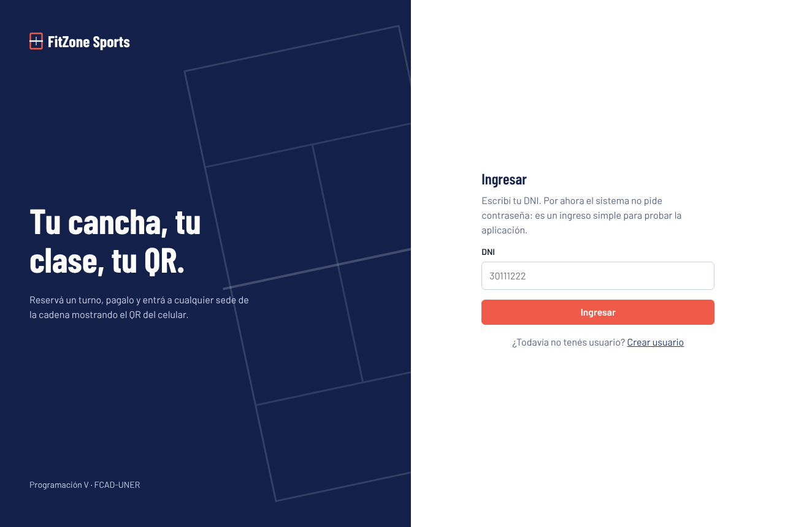

Para probar el sistema están cargados estos usuarios:

| Persona | DNI |
|---|---|
| Socia al día | 30111222 |
| Socio en mora | 30222333 |
| Cliente externo | 35444555 |
| Recepcionista | 28555666 |
| Administrador de sede | 27666777 |
| Gerente central | 25777888 |

---

## 3. Manual del Socio

### 3.1 Registro y carga del perfil

1. En la pantalla de ingreso, tocá **Crear usuario**.
2. Completá DNI, nombre completo, email y, si querés, teléfono.
3. En **Tipo de usuario** elegí **Socio, con membresía** (o **Cliente externo** si solo vas a alquilar canchas).
4. Si sos socio, elegí el **plan**: mensual, trimestral o anual. La pantalla te muestra hasta cuándo va a durar.
5. Tocá **Crear usuario**. Después ingresá con tu DNI.

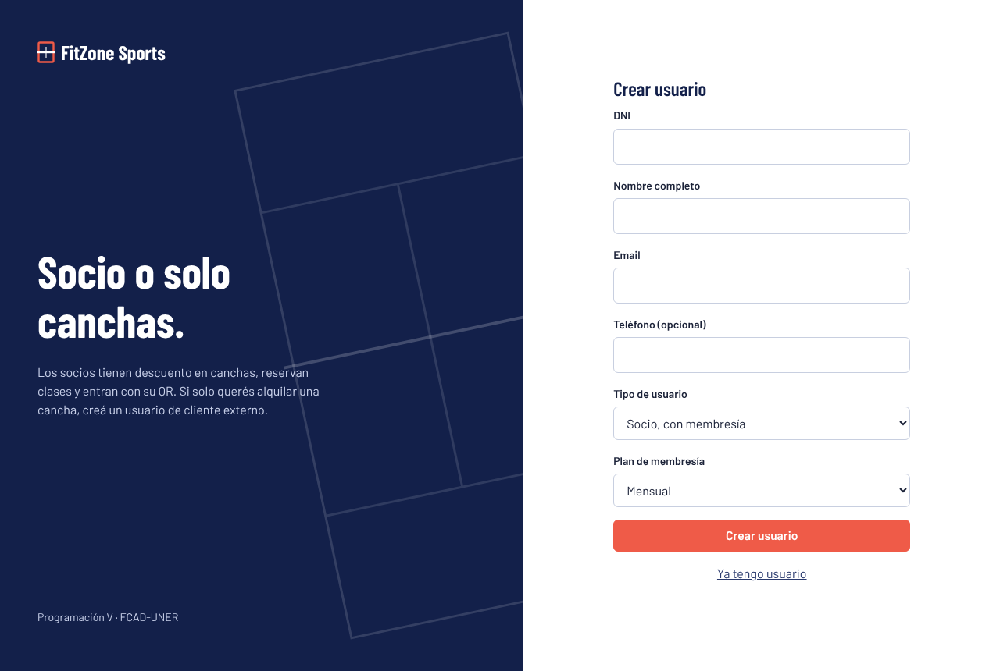

El DNI y el email no se pueden repetir: si ya están registrados, el sistema lo avisa.

### 3.2 Contratación y renovación de la membresía

La membresía se contrata al registrarse como socio (punto 3.1). En **Inicio**, el recuadro **Mi membresía** muestra el plan, el estado y las fechas de inicio y vencimiento.

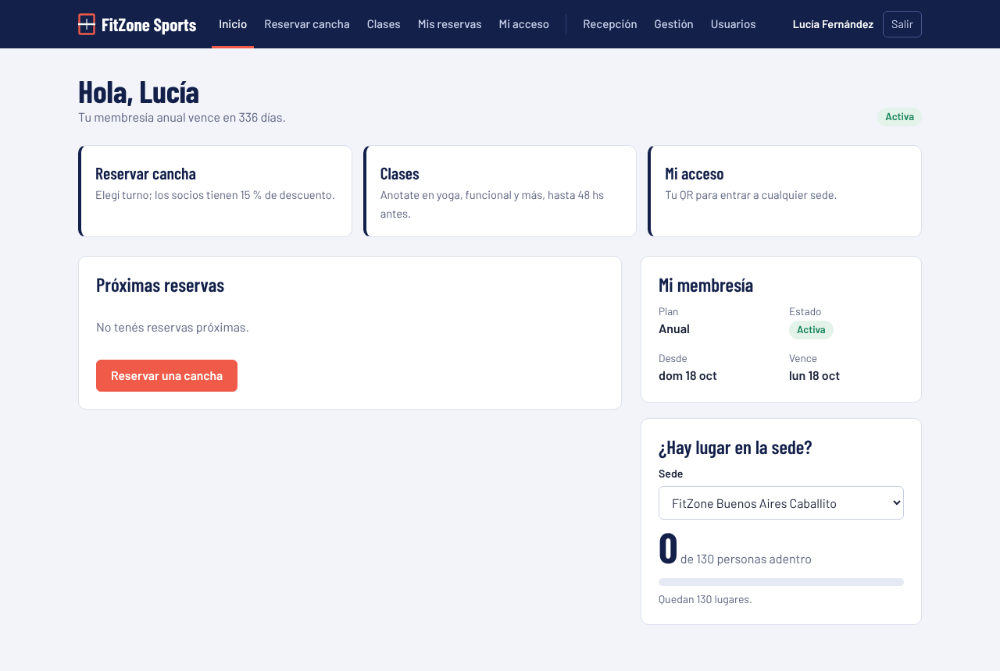

| Estado | Qué podés hacer |
|---|---|
| **Activa** | Todo: entrar, reservar clases, canchas con descuento. |
| **Vencida** | Pasa sola cuando llega la fecha de vencimiento. No podés entrar ni reservar clases; las canchas las pagás como externo. |
| **Suspendida** | La suspende la administración. Mismas restricciones que vencida. |

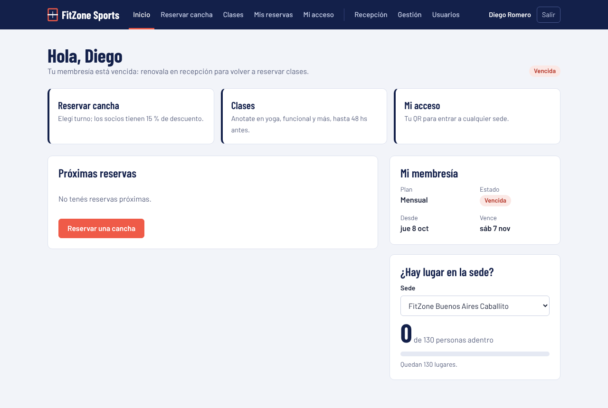

**Renovación.** En esta versión la renovación la hace el personal de la sede (o el sistema, si la membresía tiene renovación automática). Si la membresía está activa, se suman los meses del plan a la fecha de vencimiento; si estaba vencida o suspendida, el nuevo período empieza el día de la renovación. Todavía no hay un botón para que el socio renueve solo desde la aplicación.

### 3.3 Obtención del código QR desde el portal e ingreso al gimnasio

1. Al llegar a la sede, abrí **Mi acceso**.
2. En la pestaña **Con conexión** aparece tu QR. El anillo de abajo a la derecha cuenta los segundos hasta que el código cambia.
3. Acercá el QR al lector del molinete o mostráselo al recepcionista.
4. Si marca verde, pasá. Al salir, se registra tu egreso.

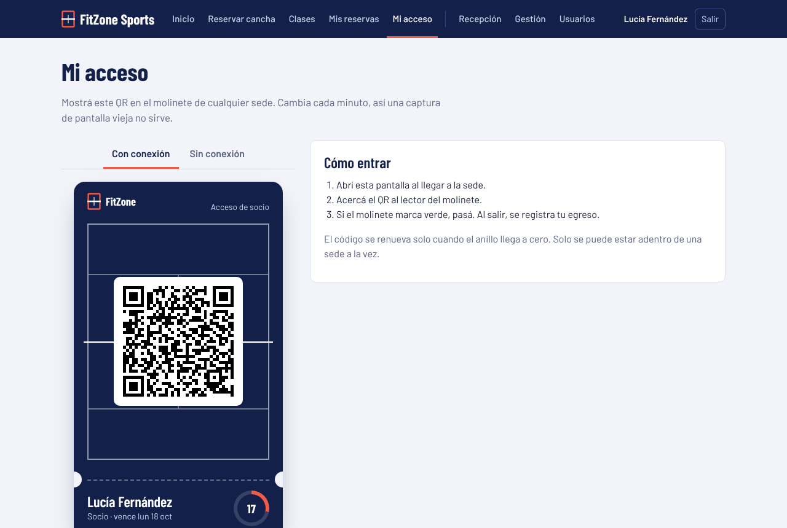

Reglas: solo podés estar adentro de **una sede a la vez**, y si la sede llegó a su aforo máximo hay que esperar a que salga alguien.

### 3.4 Qué hacer si el QR no es aceptado o la sede está sin conexión

**Si la sede se queda sin internet:** en **Mi acceso**, pestaña **Sin conexión**, aparece un segundo QR (de color coral). El molinete lo valida sin consultar al servidor. Vale **24 horas** o hasta que vence tu membresía, lo que pase primero. Conviene abrirlo cuando tenés conexión, así queda listo.

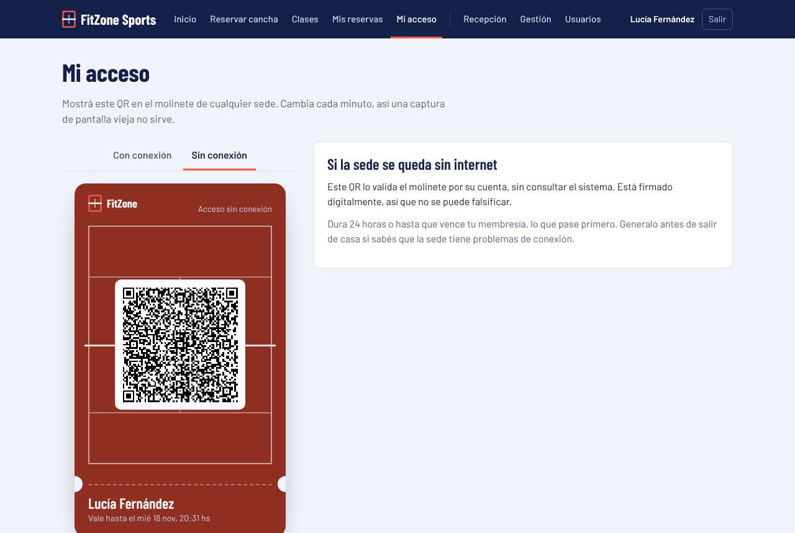

**Si el QR no es aceptado:**

| Mensaje | Qué pasa | Qué hacer |
|---|---|---|
| El código venció | Mostraste un QR de hace más de un minuto (por ejemplo, una captura) | Abrí **Mi acceso** de nuevo |
| Ya figurás adentro de otra sede | No registraste la salida en otra sede | Pedile al recepcionista que registre tu salida |
| La sede está llena | Se llegó al aforo máximo | Esperá a que salga alguien |
| Membresía vencida o suspendida | Estás en mora | Renová la membresía en el mostrador |
| El QR sin conexión venció | Pasaron sus 24 horas | Generá uno nuevo cuando tengas conexión |

### 3.5 Reserva de clases grupales y lista de espera

1. Abrí **Clases** y elegí la sede.
2. Cada clase muestra el día, la hora, el instructor y cuántos lugares quedan.
3. Tocá **Reservar lugar**. Se puede reservar hasta **48 horas antes** de la clase.

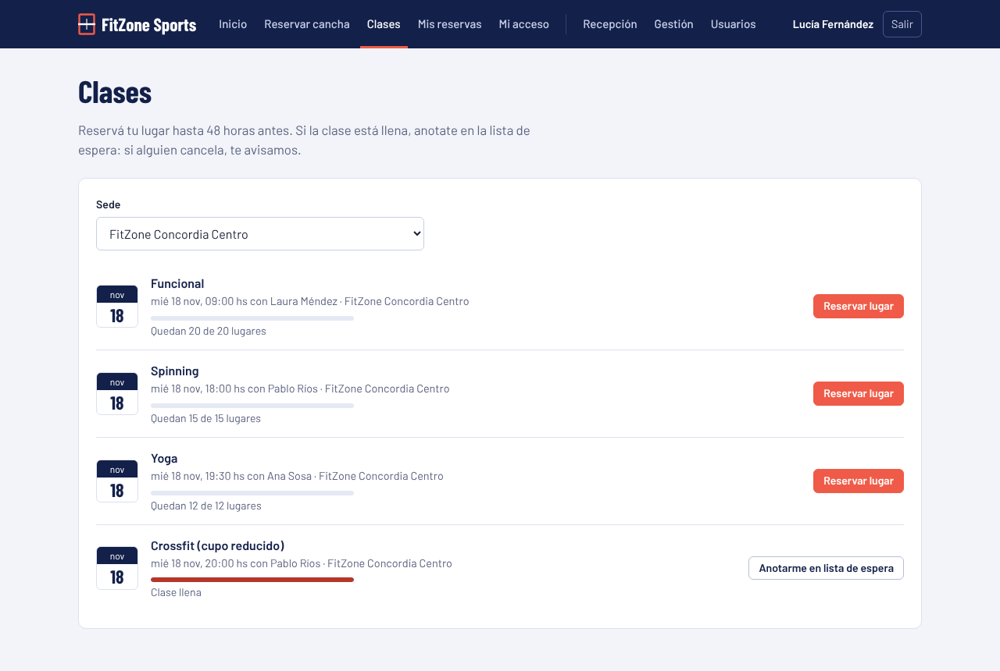

4. Cuando reservás, la clase queda **Confirmada** y aparece el botón **QR de asistencia**: mostralo al llegar a la clase (sirve desde 30 minutos antes hasta 60 minutos después del inicio).

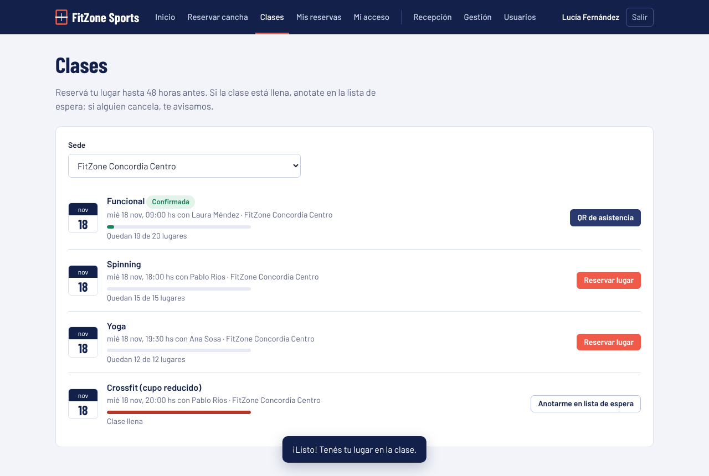

**Clase llena.** Si no quedan lugares, aparece **Anotarme en lista de espera**. Si alguien cancela, el sistema avisa al primero de la lista. Ojo: el aviso **no reserva el lugar**; tenés que entrar y reservarlo.

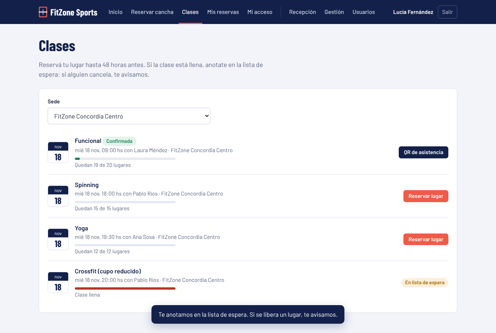

Solo los socios con la membresía activa pueden reservar clases.

### 3.6 Reserva de canchas y cómo se calcula el precio

1. Abrí **Reservar cancha**.
2. Elegí la **sede** y la **cancha** (las que están en mantenimiento aparecen deshabilitadas).
3. Elegí el **día** y un **horario libre**. Los turnos son de una hora, de 8 a 23. Los de 19 a 21 están marcados como **horario pico**.
4. A la derecha, **Tu reserva** muestra el precio con el detalle de cada concepto.
5. Tocá **Reservar y pagar**.

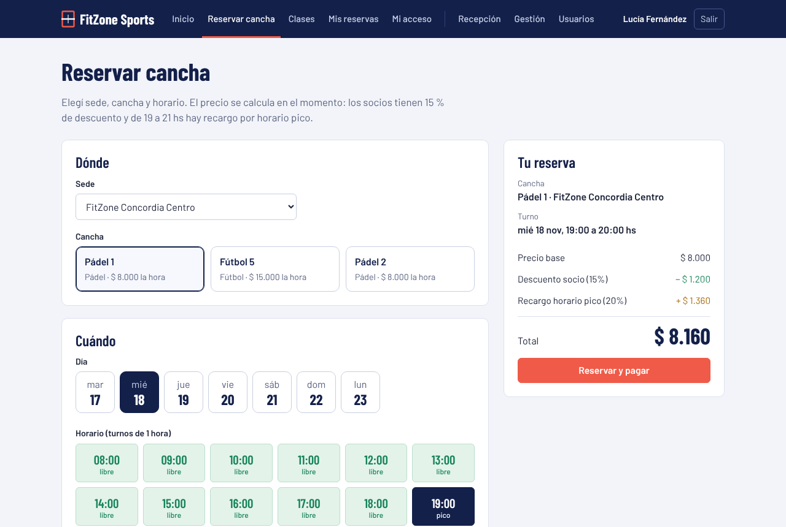

**Cómo se calcula el precio:**

| Concepto | Regla |
|---|---|
| Precio base | El precio por hora de la cancha |
| Descuento de socio | −15 %, solo si tu membresía está activa |
| Recargo por horario pico | +20 % para los turnos de 19 a 21 hs |

Ejemplo con una cancha de pádel de $ 8.000 a las 19 hs: un socio al día paga 8.000 − 15 % = 6.800, y + 20 % = **$ 8.160**. Un cliente externo o un socio en mora paga 8.000 + 20 % = **$ 9.600**.

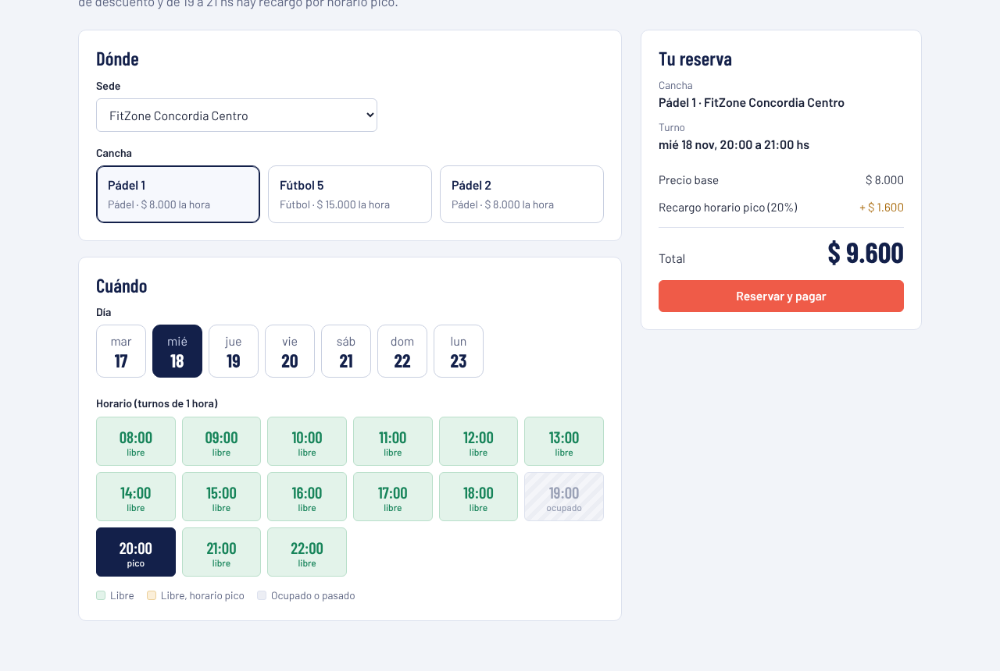

**Pago.** Se abre la ventana de pago: completá los datos de la tarjeta y tocá **Pagar**. Si la tarjeta es rechazada, la reserva queda pendiente y podés intentar con otra.

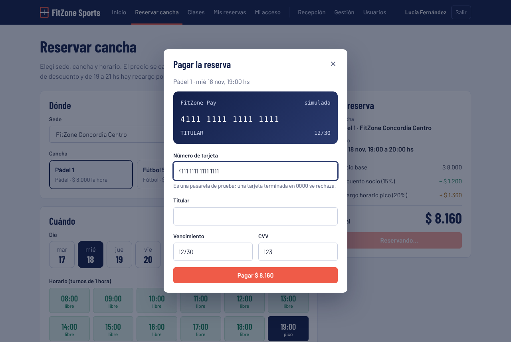

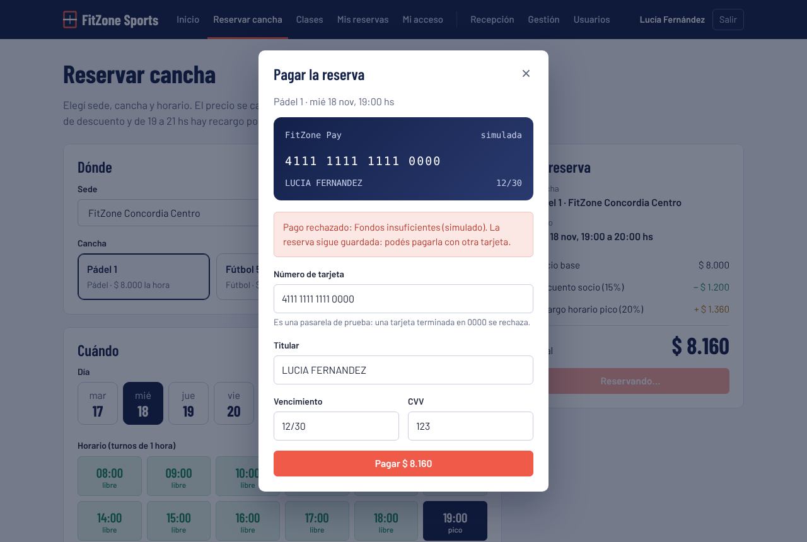

Cuando el pago se aprueba, la reserva queda **confirmada** y aparece el QR para entrar a la sede, con el botón **Descargar comprobante**.

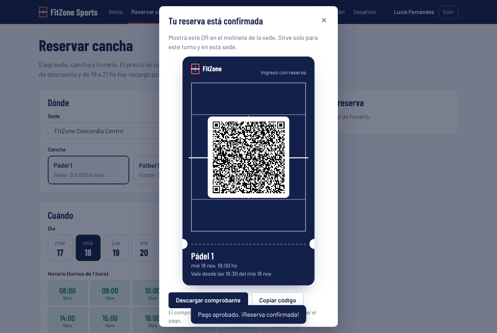

**Si otra persona reservó el mismo turno un segundo antes**, el sistema avisa «Ese turno acaba de ser reservado por otro usuario»: elegí otro horario. Nunca se confirman dos reservas para la misma cancha y horario.

**Cliente externo:** en **Mi acceso** aparecen tus próximas reservas pagas, cada una con su QR para entrar a la sede (desde 30 minutos antes del turno).

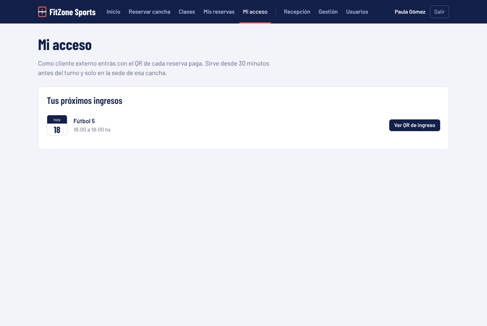

### 3.7 Cancelaciones, plazos y penalidades

Todas las reservas están en **Mis reservas**, en tres pestañas: canchas, clases y pagos. Cada reserva activa tiene el botón **Cancelar**.

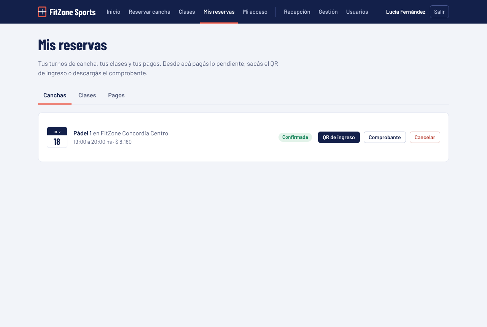

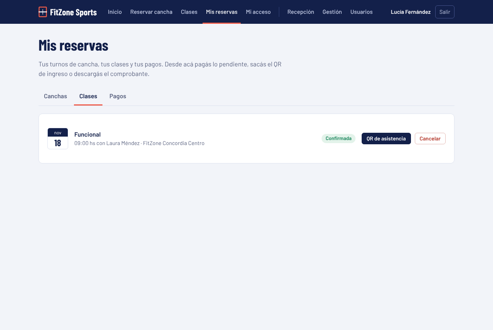

| Qué cancelás | Plazo | Consecuencia |
|---|---|---|
| Reserva de cancha | Hasta antes del turno | Sin penalidad; el turno queda libre para otra persona |
| Clase, con más de 2 horas de anticipación | — | Sin penalidad |
| Clase, con menos de 2 horas de anticipación | — | La reserva queda **con penalidad** |

Al cancelar una clase llena, se avisa al primero de la lista de espera.

### 3.8 Comprobantes de pago

En **Mis reservas → Pagos** está el historial de pagos, aprobados y rechazados, con el botón **Comprobante** en los aprobados.

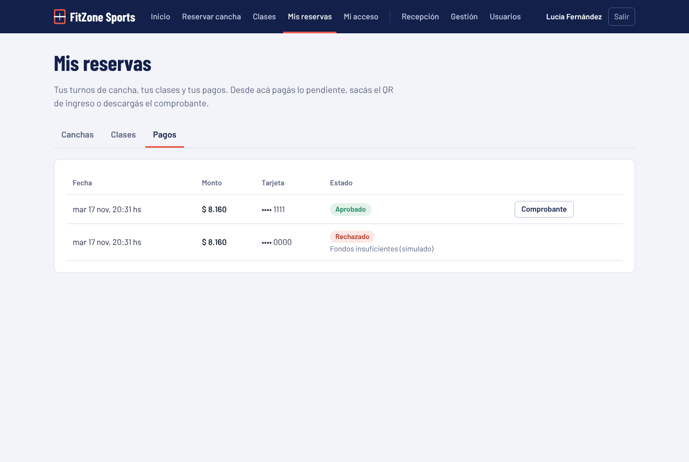

El comprobante es un PDF con los datos del pago, la cancha, la sede y el cliente, y dos códigos QR:

- el **QR de ingreso**, para entrar a la sede el día del turno;
- el **QR de verificación**: al escanearlo se comprueba que el comprobante es auténtico y que el monto no fue modificado.

En la tarjeta solo se muestran los últimos 4 dígitos: FitZone no guarda el número de tu tarjeta.

---

## 4. Manual del Recepcionista / Administrador de sede

### 4.1 Validación de ingreso y lectura del aforo

1. Abrí **Recepción** y elegí tu **sede** arriba a la derecha.
2. Tocá **Usar la cámara** y apuntá al QR que muestra la persona, o pegá el código en el recuadro y tocá **Validar**.
3. El sistema reconoce solo qué QR es: el del socio, el de una reserva de cancha, el de asistencia a una clase, el QR sin conexión o el de un comprobante.
4. El resultado aparece abajo: **Puede pasar** en verde, o **No puede pasar** en rojo con el motivo.

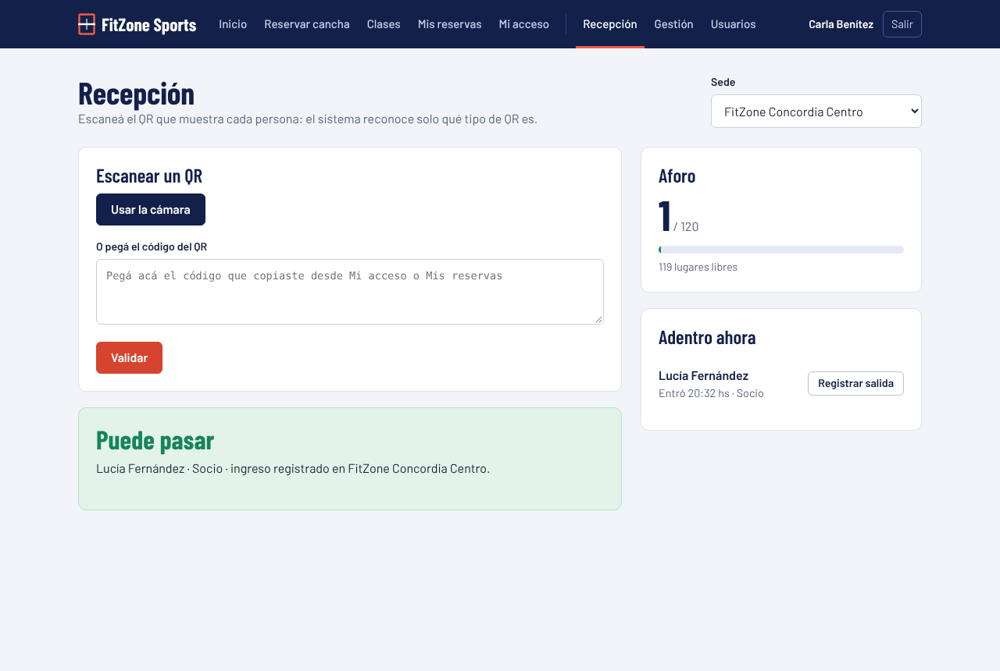

A la derecha están el **aforo** (cuántas personas hay y cuántos lugares quedan) y la lista de quienes están **adentro ahora**, con el botón **Registrar salida**. Se actualizan solos cada 15 segundos.

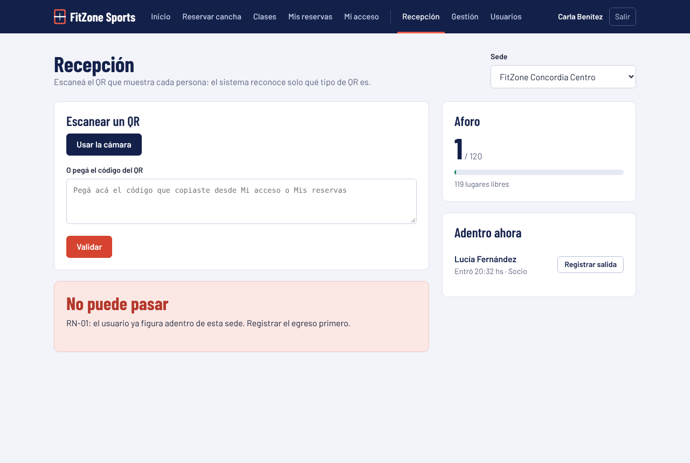

### 4.2 Gestión de la agenda de clases

1. Abrí **Gestión → Clases**.
2. A la izquierda están las próximas clases de todas las sedes con sus lugares.
3. Para programar una clase: elegí la sede, la actividad, el instructor, el día y la hora, y el cupo. Tocá **Programar clase**.

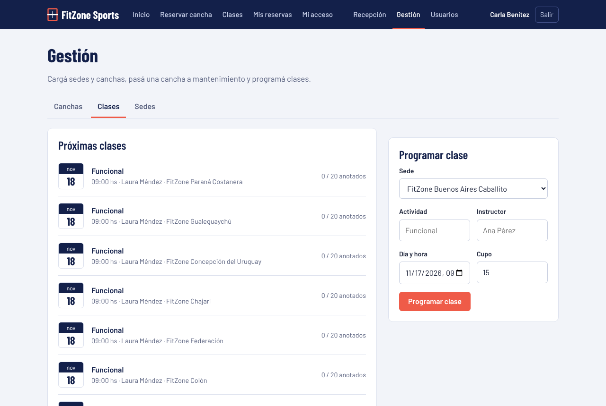

### 4.3 Inhabilitación de una cancha por mantenimiento

1. Abrí **Gestión → Canchas** y elegí la sede.
2. En la columna **Estado**, cambiá la cancha a **En mantenimiento** (o **Inactiva**).
3. Desde ese momento la cancha aparece deshabilitada en **Reservar cancha**. Para volver a habilitarla, ponela en **Disponible**.

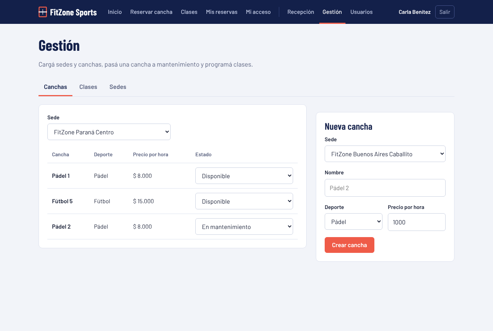

Las reservas ya hechas para esa cancha no se cancelan solas: avisá a los clientes y cancelalas si corresponde.

### 4.4 Problemas frecuentes del mostrador y cómo resolverlos

| Situación | Qué hacer |
|---|---|
| «Ya figura adentro de otra sede» | La persona no registró la salida en otra sede. Desde la Recepción de esa sede, **Registrar salida**; después volvé a validar. |
| «La sede está llena» | Se llegó al aforo. Esperá a que salga alguien o registrá las salidas pendientes. |
| «El código venció» | La persona mostró una captura vieja. Que abra **Mi acceso** otra vez. |
| La cámara no lee | Revisá que el navegador tenga permiso para la cámara, o pedile a la persona que copie el código y pegalo en el recuadro. |
| Se cortó internet en la sede | Pedí el **QR sin conexión** (pestaña **Sin conexión** en Mi acceso). La pantalla lo valida sola, sin el servidor; ver 4.5. Los otros QR necesitan conexión. |
| Un cliente externo no tiene QR | Su QR aparece en **Mi acceso** o en el comprobante solo si la reserva está **paga**, y sirve desde 30 minutos antes del turno. |

### 4.5 Si se corta la conexión con el servidor

El panel **Terminal**, arriba a la derecha, dice si la pantalla está **En línea** o **Sin conexión** y cuántos ingresos faltan sincronizar.

1. Sin conexión, pedile a la persona el **QR sin conexión** (en **Mi acceso → Sin conexión**, el QR coral).
2. Escanealo o pegalo como siempre. Si dice **Puede pasar**, la pantalla verificó la firma del QR ella sola y anotó el ingreso con la hora.
3. Si dice **La firma no es válida** o **venció**, no puede pasar.
4. Cuando vuelve la conexión, los ingresos anotados se envían solos en menos de 15 segundos (o tocá **Sincronizar ahora**) y la persona aparece en **Adentro ahora** con la hora en que entró.

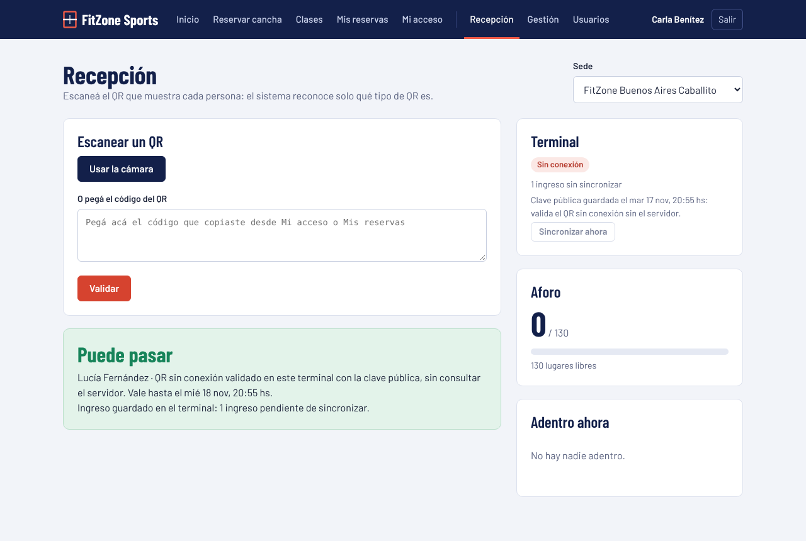

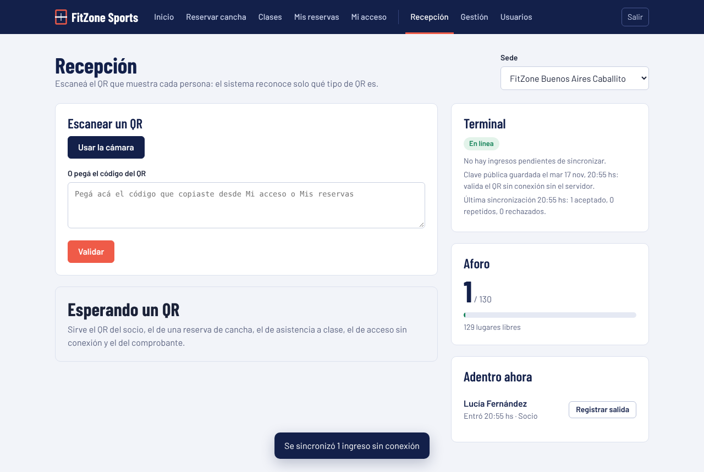

Mientras no hay conexión no se ven el aforo ni la lista de presentes, y no se pueden registrar salidas: registralas cuando vuelva la conexión. Si al sincronizar aparece una observación (por ejemplo, alguien que figuraba adentro de otra sede), queda anotada en el panel Terminal.

---

## 5. Manual del Gerente central

### 5.1 Alta y configuración de una sede

1. Abrí **Gestión → Sedes**.
2. Completá **nombre**, **dirección** y **aforo máximo**, y tocá **Crear sede**.
3. En **Gestión → Canchas**, cargá las canchas de la sede nueva (nombre, deporte y precio por hora).
4. En **Gestión → Clases**, programá sus clases.

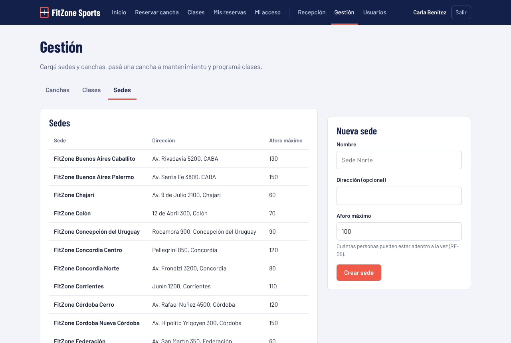

La sede queda disponible al instante, sin reiniciar el sistema. El nombre de cada sede no se puede repetir.

### 5.2 Definición de precios, descuentos y horario pico

| Qué | Dónde se define |
|---|---|
| Precio por hora de cada cancha | Al darla de alta en **Gestión → Canchas** |
| Descuento de socio (15 %) | Regla fija del sistema |
| Recargo por horario pico (20 %, de 19 a 21 hs) | Regla fija del sistema |

El descuento y el recargo son reglas de negocio programadas (patrón Strategy, ADR-013). Cambiar un porcentaje, el horario pico o agregar una regla nueva (por ejemplo, un recargo de fin de semana) lo hace el equipo técnico: el manual técnico explica cómo. En esta versión no hay una pantalla para editarlos.

### 5.3 Lectura de los reportes consolidados

En esta versión **no hay un tablero de reportes consolidados**: se había hecho uno en la Unidad III y se quitó por indicación de la cátedra. La información disponible hoy es:

| Información | Dónde |
|---|---|
| Ocupación de cada sede en este momento | **Inicio → ¿Hay lugar en la sede?** y **Recepción → Aforo** |
| Quiénes están adentro de una sede | **Recepción → Adentro ahora** |
| Socios y clientes, con el estado de su membresía | **Usuarios** |
| Clases programadas y sus lugares | **Gestión → Clases** |

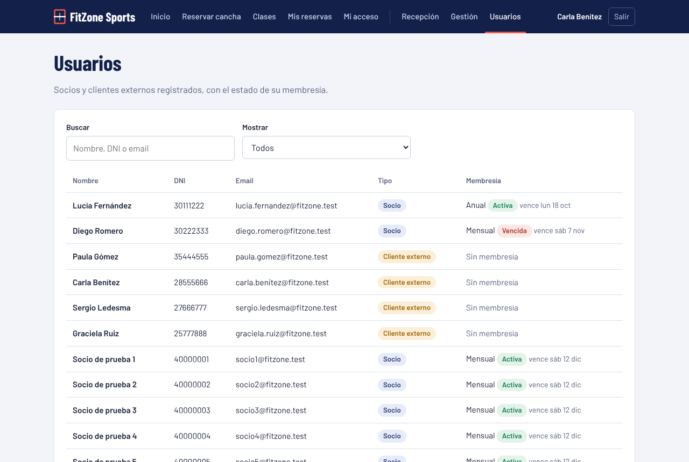

---

## 6. Preguntas frecuentes

**¿Puedo entrar con una captura de pantalla del QR?**
No. El QR rotativo cambia cada minuto. Si te quedás sin conexión, usá el QR de la pestaña **Sin conexión**.

**¿Puedo estar en dos sedes el mismo día?**
Sí, pero no al mismo tiempo: tenés que registrar la salida de una antes de entrar a otra.

**¿Por qué pago más que otro socio por la misma cancha?**
Porque tu membresía no está activa (vencida o suspendida): pagás como cliente externo. Al renovarla vuelve el descuento.

**¿Por qué cambia el precio según el horario?**
De 19 a 21 hs hay un recargo del 20 % por horario pico.

**Me avisaron que se liberó un lugar en una clase, ¿ya estoy anotado?**
No. El aviso te da la oportunidad; tenés que entrar a **Clases** y reservar.

**Cancelé una clase y dice «con penalidad».**
Cancelaste con menos de 2 horas de anticipación.

**Mi tarjeta fue rechazada, ¿perdí el turno?**
No: la reserva queda pendiente y podés pagar con otra tarjeta. Mientras tanto, el turno sigue apartado para vos.

**¿FitZone guarda los datos de mi tarjeta?**
No. Solo se guarda un código que entrega la pasarela de pagos y los últimos 4 dígitos.

**¿Cómo sé que un comprobante es verdadero?**
Escaneá su QR de verificación (o pegalo en **Recepción**): el sistema confirma si es auténtico y si el monto coincide.
