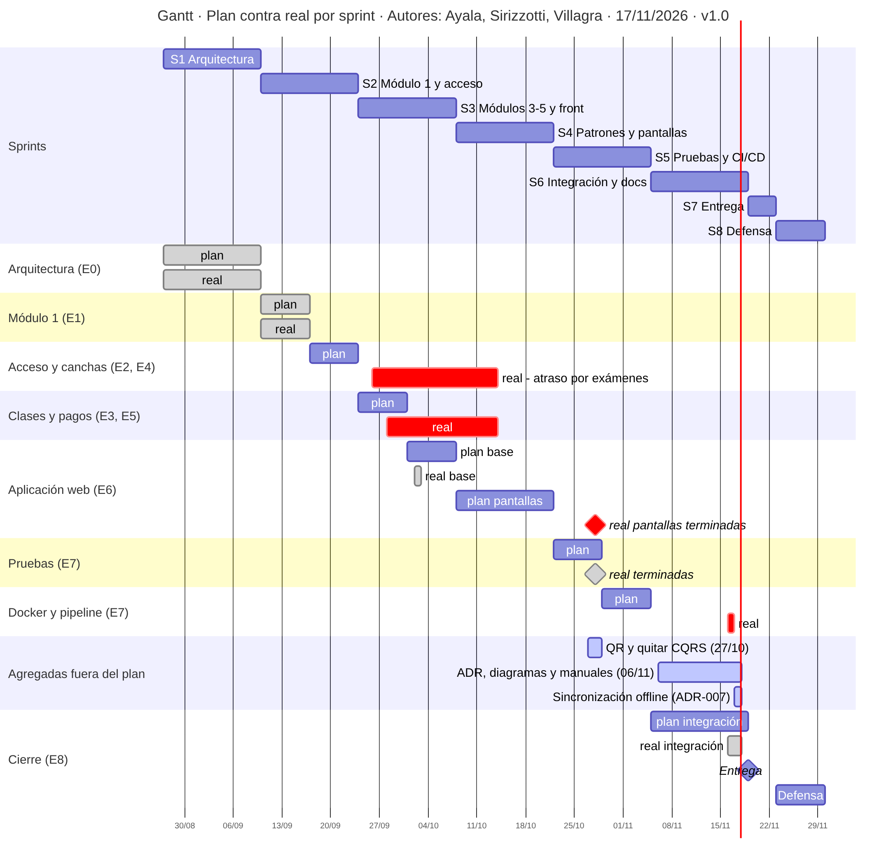

# 3. Cronograma

La cursada empezó el 27/08 y termina el 20/11: 13 semanas en lugar de las 16 del programa, con las mismas 76 horas prácticas (versión 1 del plan). Se organizó en sprints de dos semanas con líder rotativo. En la versión 4 (17/11) el último tramo se partió en dos, siguiendo el reacomodamiento de la cátedra (entrega el 19/11 y defensa del 23 al 29/11). Así quedan los ocho sprints.

| Sprint | Fechas | Objetivo | Capacidad (h del plan) | Entregable de cierre | Líder previsto | Check-in real |
|---|---|---|---|---|---|---|
| 1 | 27/08 – 09/09 | Decidir la arquitectura y armar el esqueleto del backend | 12 | C4 de contexto y contenedores, ADR iniciales, backend con inyección de dependencias | Sirizzotti | 03/09 · Sirizzotti |
| 2 | 10/09 – 23/09 | Módulo 1 completo; acceso y canchas | 16 | Esquema SQL, API de usuarios y membresías | Ayala | 17/09 · Ayala no pudo asistir; pasó al 01/10 |
| 3 | 24/09 – 07/10 | Clases y pagos; base de la aplicación web | 8 | Los cinco módulos armados en el backend; ingreso, panel y usuarios en la web | Villagra | 01/10 · Ayala (check-in del sprint 2 corrido por la mesa de exámenes del 22 al 28/09) |
| 4 | 08/10 – 21/10 | Patrones de diseño (Unidad III) y pantallas de reserva | 10 | Strategy, Observer y Repository aplicados; pantallas de reservas | Sirizzotti | 15/10 · Villagra |
| 5 | 22/10 – 04/11 | Pruebas automáticas e integración continua | 12 | 99 pruebas con Jest y Supertest; pipeline y Docker | Ayala | 29/10 · Sirizzotti |
| 6 | 05/11 – 18/11 | Recuperar el atraso, reforzar RNF e integrar | 16 | Sistema integrado, ADR, diagramas y manuales según los lineamientos del 06/11 | Villagra | — |
| 7 | 19/11 – 22/11 | Entrega | 1 | Tag `v1.0-entrega`, dossier, planificación y registro subidos al campus | Sirizzotti | 19/11 · Ayala (entrega) |
| 8 | 23/11 – 29/11 | Defensa | 1 | Demo de cinco minutos y revisión técnica | — | — |
| | | | **76** | | | |

Desde el sprint 2 la rotación real quedó corrida un turno respecto de la prevista: Ayala no pudo presentar el 17/09, la semana siguiente fue de mesa de exámenes y su check-in pasó al 01/10. El orden siguió desde ahí (Villagra el 15/10, Sirizzotti el 29/10) y a Ayala le vuelve a tocar en la entrega del 19/11.

La capacidad es la suma de las horas que el plan asignó a cada semana del sprint. Lo que realmente se completó y se trabajó en cada uno está en [06-seguimiento.md](06-seguimiento.md).

## Vista visual

Fuente editable: [gantt.mmd](gantt.mmd). Las barras rojas son tareas que terminaron fuera de su sprint; los rombos marcan la fecha de terminación cuando no hay registro de la fecha de inicio. La línea roja vertical es el 17/11, la fecha de esta versión.
