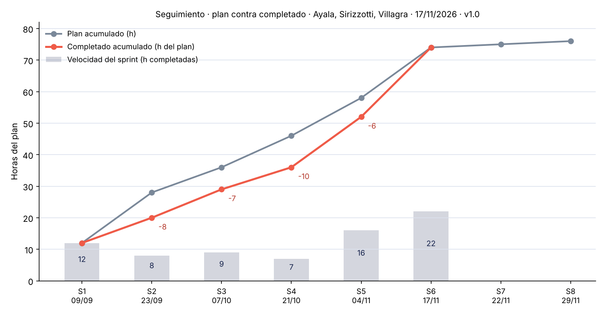

# 6. Seguimiento por sprint

## Cómo se mide

- **Comprometido:** horas del plan de las tareas del sprint, más las que venían arrastradas sin terminar del sprint anterior.
- **Completado:** horas del plan de las tareas que se terminaron dentro del sprint, según la planilla y las bitácoras. Es la **velocidad** del sprint.
- **Trabajado:** horas efectivas que cada integrante anotó en su bitácora. Sirve para comparar el esfuerzo real con lo estimado.
- **Desvío acumulado:** completado acumulado menos plan acumulado (el plan original, sin arrastres).
- **Agregadas:** tareas que surgieron durante el sprint, casi siempre por indicación de la cátedra, sin estimación en el plan.

## 6.1 Estimado contra completado

| Sprint | Plan del sprint | Arrastre | Comprometido | Completado (velocidad) | Desvío del sprint | Plan acum. | Completado acum. | Desvío acum. |
|---|---|---|---|---|---|---|---|---|
| 1 | 12 | 0 | 12 | 12 | 0 | 12 | 12 | 0 |
| 2 | 16 | 0 | 16 | 8 | −8 | 28 | 20 | −8 |
| 3 | 8 | 8 | 16 | 9 | −7 | 36 | 29 | −7 |
| 4 | 10 | 7 | 17 | 7 | −10 | 46 | 36 | −10 |
| 5 | 12 | 10 | 22 | 16 | −6 | 58 | 52 | −6 |
| 6 | 16 | 6 | 22 | 22 | 0 | 74 | 74 | 0 |
| 7 | 1 | 0 | 1 | — | — | 75 | — | — |
| 8 | 1 | 0 | 1 | — | — | 76 | — | — |

Velocidad media de los sprints 1 a 6: 12,3 horas del plan por sprint (74 / 6).

## 6.2 Trabajado según las bitácoras (horas)

| Sprint | Ayala | Villagra | Sirizzotti | Total registrado |
|---|---|---|---|---|
| 1 | 13 | 4 | 2 (e) | 19 |
| 2 | 5 | 0 | 3 (e) | 8 |
| 3 | 3 | 1 (4) | 4 (e) | 8 |
| 4 | 2 | 8 (1) (4) | 13 (e) | 23 |
| 5 | 2 | 6 (1) | 13 (e) | 21 |
| 6 | 6 (2) | 11 (5) | 22 (e) (3) | 39 |

- **(e)** Sirizzotti no anotó las horas en el momento: son una estimación suya hecha al cierre (19/11), entrada por entrada en su bitácora. Las revisiones con Villagra del 12/10 y el 27/10 llevan las mismas horas que en la bitácora de Villagra (7 y 6). En el sprint 7 suma 8 horas más (19/11).
- (1) Revisión de las pantallas del frontend junto con Sirizzotti, por Discord (12/10 y 27/10): Sirizzotti le pasaba las pantallas y Villagra las corregía contra lo que había que entregar. El código lo terminó Sirizzotti (ver 4.3).
- (2) Ayala, 17/11: ADR, esquema SQL con datos de prueba y README (2 h; `bd48c52`, `ace9ac7`, `3273b98`), y diagramas C4, DER y despliegue con el manual técnico (4 h; `2a4bbd5`, `05c0596`, `bc15e18`).
- (3) Del 05 al 18/11: Docker y pipeline, ADR, diagramas, manuales, sincronización sin conexión y reorganización del repositorio.
- (4) Check-ins: participación en el del 01/10 (1 h) y el del 15/10, que lideró (1 h).
- (5) ADR-006, 007 y 010 (08/11, 6 h) y los tres diagramas de actividad y de estados con el manual de usuario (17/11, 5 h).

Con horas registradas tan incompletas, el trabajado no permite una comparación seria contra lo estimado: la falta de registro es en sí misma un hallazgo del seguimiento (ver [08-analisis-de-desvios.md](08-analisis-de-desvios.md)). Por eso la velocidad se mide en horas del plan completadas, que sí se pueden verificar contra la planilla y el repositorio.

## 6.3 Observaciones por sprint

| Sprint | Qué pasó | Agregadas |
|---|---|---|
| 1 | Se cumplió el plan: arquitectura, C4, ADR y esqueleto del backend. | Se quita la app móvil (29/08). |
| 2 | Módulo 1 y esquema SQL a tiempo (16/09). El check-in del 17/09 no se hizo: Ayala no pudo asistir y la semana siguiente fue de mesa de exámenes. Acceso y canchas no empezaron. | Esquema SQL versionado con índice único para RN-02. |
| 3 | Ayala armó Acceso, Clases, Canchas y Pagos (26/09 al 01/10). Sirizzotti hizo la base del frontend (02/10), que era de Villagra. Check-in del sprint 2 el 01/10. | — |
| 4 | Se aplicaron los tres patrones (13/10), atrasados un sprint. Las pantallas de reservas no avanzaron. | — |
| 5 | Se recuperó el frontend (28/10, por Sirizzotti) y se escribieron 99 pruebas. La cátedra pidió quitar CQRS, un ADR por patrón y permitió más de un QR (check-in del 15/10; el equipo lo supo el 27/10): se hicieron en dos días. Docker y el pipeline no llegaron. | Quitar CQRS, ADR por patrón, cuatro QR, bitácoras personales. |
| 6 | Los lineamientos nuevos (06/11) sumaron 10 ADR, 14 diagramas, 3 manuales y esta planificación. Se usó el colchón de la semana 11. Docker y pipeline el 16/11, sincronización offline y pruebas de punta a punta el 17/11. Desvío acumulado en cero. El 18/11 se reorganizó el repositorio según el punto 4 de los lineamientos y se agregaron la evidencia de los RNF y la prueba de concurrencia. | 10 ADR, 14 diagramas, 3 manuales, planificación, ADR-007, reorganización del repositorio, evidencia de RNF. |
| 7 y 8 | Pendientes: entrega el 19/11 y defensa del 23 al 29/11. | — |
