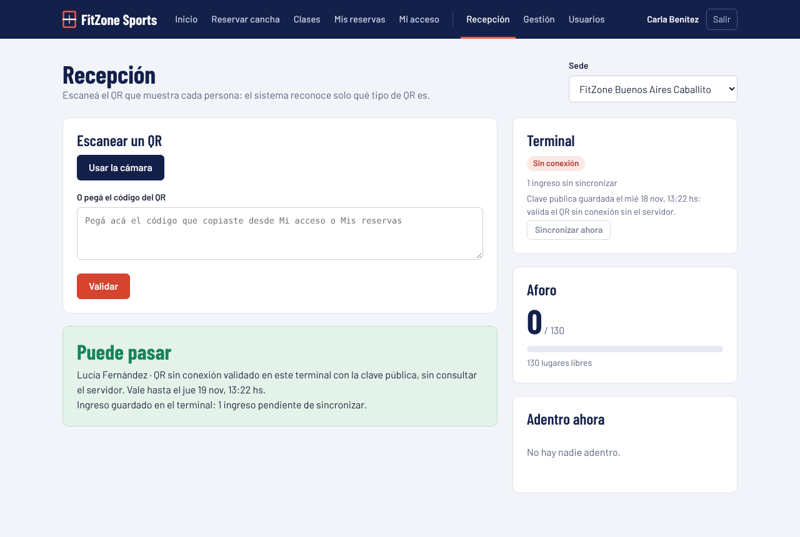
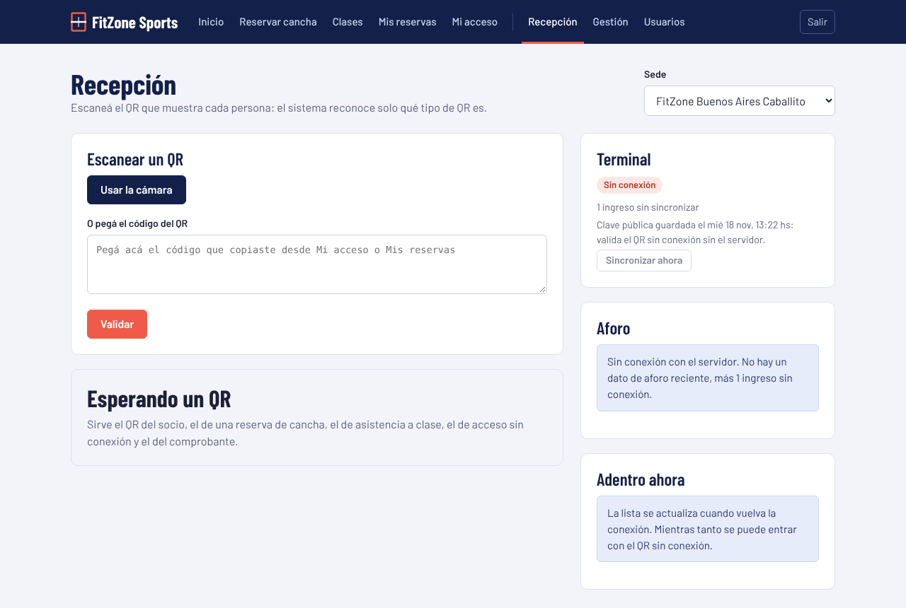
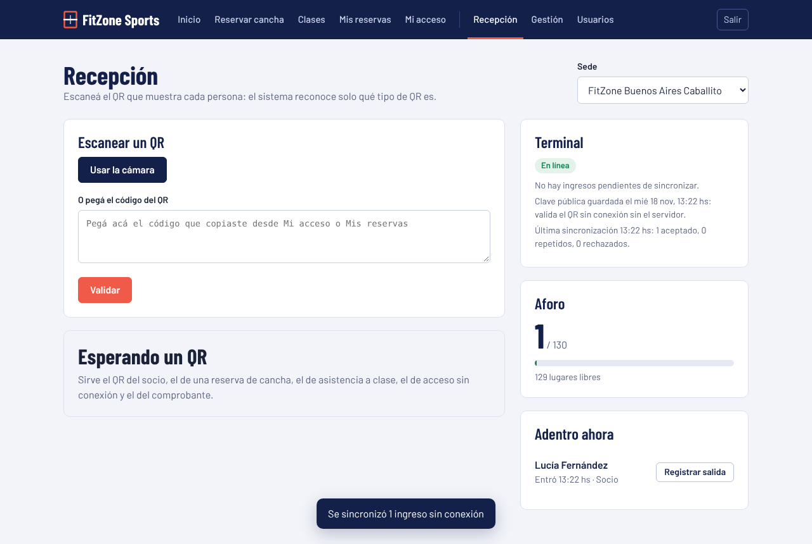

# RNF-01 · Disponibilidad del control de acceso

> El control de acceso (tornos) debe funcionar aunque falle la conexión principal a internet.

## Cómo se cumple

1. El socio baja desde **Mi acceso → Sin conexión** un QR firmado con Ed25519 que vale 24 horas (ADR-003, `backend/src/acceso/qr-offline.js`).
2. El terminal de Recepción guarda en el navegador la clave pública, la lista de sedes y una cola de ingresos (`frontend/src/services/terminal-offline.js`).
3. Sin servidor, verifica la firma ahí mismo con WebCrypto, deja pasar y anota el ingreso con su hora.
4. Al volver la conexión, manda la cola a `POST /api/v1/acceso/sincronizar`. El servidor vuelve a verificar cada firma con la hora del ingreso, descarta reenvíos y resuelve RN-01 (ADR-007).

## Pruebas automáticas

| Prueba | Casos | Qué verifica |
|---|---|---|
| `backend/test/unit/qr-offline.test.js` | 8 | La firma se valida solo con la clave pública, sin base; un QR adulterado o vencido se rechaza |
| `backend/test/unit/sincronizacion-terminal.test.js` | 11 | La sincronización: hora original, reenvíos sin duplicar, firmas adulteradas, QR vencido al ingresar, RN-01 y aforo |
| `backend/test/integracion/qr.api.test.js` | 6 | Emisión, validación, clave pública y `POST /acceso/sincronizar` por HTTP |

## Prueba con el navegador (18/11/2026)

Recepción abierta como Carla (recepcionista), con la API cortada a mitad de la prueba:

| Paso | Resultado |
|---|---|
| Con conexión | Panel Terminal «En línea», clave pública guardada |
| Se corta la API; se lee el QR sin conexión de Lucía | «Puede pasar», validado en el terminal; 1 ingreso sin sincronizar |
| Se lee un QR con la firma alterada | «No puede pasar: la firma no es válida» |
| Se recarga la página sin API | Sigue andando, con la sede y la cola guardadas; en la base todavía hay 0 ingresos |
| Vuelve la API | Se sincroniza solo: 1 aceptado; en la base queda el ingreso con la hora en que pasó |
| Con conexión, el mismo QR otra vez | «No puede pasar: RN-01, ya figura adentro» |

Cómo repetirlo: manual de instalación y operación, sección 8.

## Límites

Sin conexión no se registran egresos y el aforo no se actualiza. El navegador del terminal necesita Ed25519 en WebCrypto (Chrome o Edge 137, Firefox 129, Safari 17) y la página tiene que abrirse desde `localhost` o `https`.
